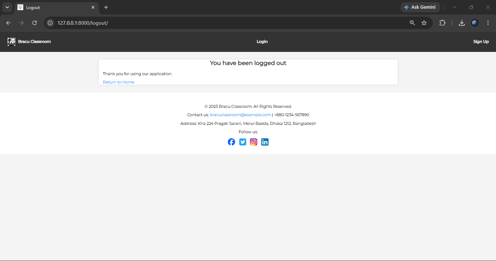
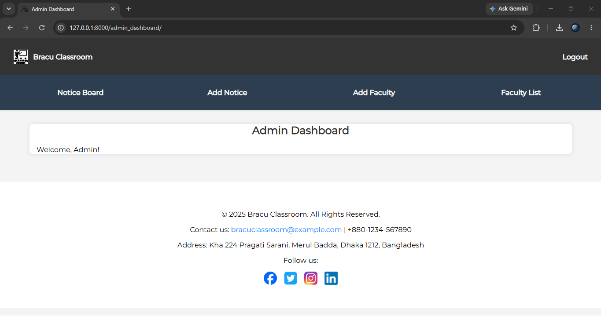
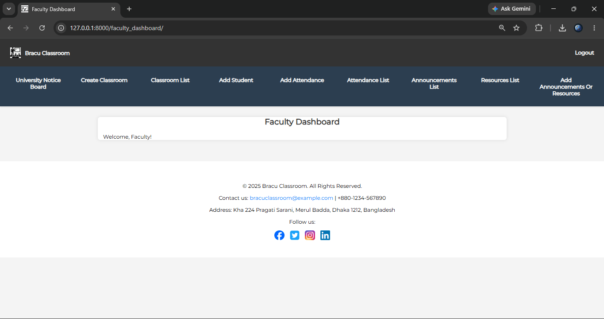
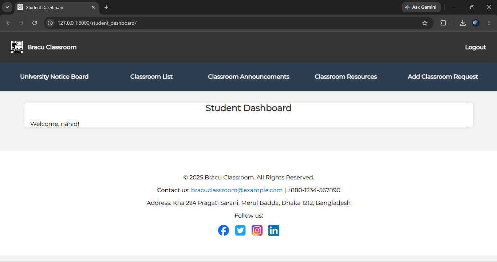
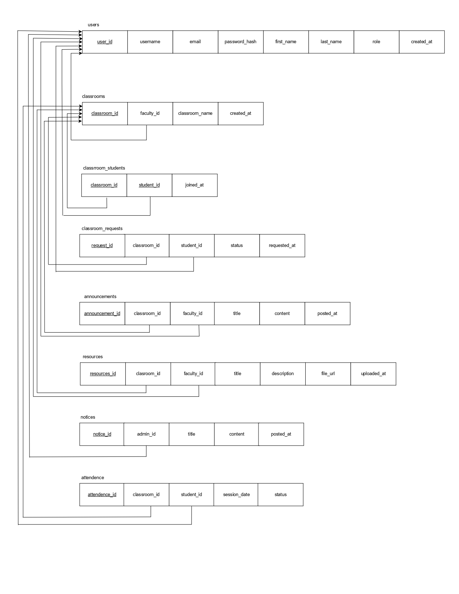

# About The Project
**BRACU Classroom** is a web-based classroom management system inspired by Google Classroom, built with Django. It supports three user roles: **Admin**, **Faculty** and **Student**. Each role gets its own dashboard and permissions. **Students** can sign up, request to join classrooms, and view announcements, resources and the university notice board. **Faculty** can create classrooms, approve or reject join requests, take attendance, and post announcements and learning resources. The **Admin** manages faculty accounts and the university's central notice board. This project was developed as part of the CSE391 (Programming for the Internet) course project at BRAC University.
<p align="right">(<a href="#readme-top">back to top</a>)</p>

# Built With
| Frontend | Backend | Database |
|---------|---------|----------|
|  |  |  |
|  |  |  |
|  |  |  |
<p align="right">(<a href="#readme-top">back to top</a>)</p>

# How To Run
Make sure you have [Python 3.10+](https://www.python.org/downloads/) and [Git](https://git-scm.com/downloads) installed, then follow these steps:

1. **Clone the repository**
   ```bash
   git clone https://github.com/azizulkabirjayed/4-bracu-classroom.git
   cd 4-bracu-classroom
   ```

2. **Create and activate a virtual environment** (recommended)
   ```bash
   python -m venv venv
   venv\Scripts\activate        # Windows
   source venv/bin/activate     # macOS / Linux
   ```

3. **Install Django**
   ```bash
   pip install django
   ```

4. **Apply database migrations**
   ```bash
   python manage.py migrate
   ```

5. **Create the Admin account.** There is only one Admin, and it is created manually. First create a superuser, then give it the `admin` role (replace `admin` with the username you chose):
   ```bash
   python manage.py createsuperuser
   python manage.py shell -c "from app1.models import All_Users; All_Users.objects.filter(username='admin').update(role='admin')"
   ```

6. **Run the development server**
   ```bash
   python manage.py runserver
   ```

7. **Open the app** at **http://127.0.0.1:8000/** in your browser. Log in as the **Admin** to create faculty accounts and post notices, use **Sign Up** to create a **Student** account, or log in with a **Faculty** account (created by the Admin) to create classrooms.

> **Note:** The repository includes a `db.sqlite3` file with sample data. If you'd rather start with an empty database, delete `db.sqlite3` before step 4.
<p align="right">(<a href="#readme-top">back to top</a>)</p>

# Sample Visualizations




<p align="right">(<a href="#readme-top">back to top</a>)</p>


# Database Schema Diagram

<p align="right">(<a href="#readme-top">back to top</a>)</p>


